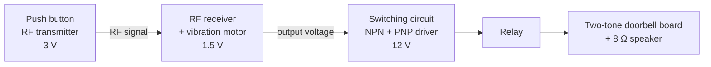

# Wireless Doorbell with Vibration Alert

**ITE (NITEC) final project · 3-person team · Hardware build, circuit integration and troubleshooting**

A battery-powered wireless doorbell with a sound alert and a vibration alert, built for elderly and hearing-impaired people who can miss a standard doorbell. A visitor presses a button outside the door. A receiver inside, in a portable box the user can keep nearby, plays a chime and vibrates. The range is about 25 m, including through a closed door.

---

## The problem

A normal doorbell only makes a sound and is fixed to one place. People who are hard of hearing, or who are in another room, may not know someone is at the door. We wanted an alert they could feel as well as hear, in a box small enough to carry around the home.

## How it works

1. **Transmitter:** pressing the button turns on the RF transmitter (3 V), which sends a signal that passes through walls and doors.
2. **Receiver:** when the receiver (1.5 V) detects the signal, it lights an LED, runs the vibration motor, and outputs a voltage.
3. **Switching circuit (our own design):** the receiver output drives an NPN transistor. The NPN switches a PNP transistor, and the PNP energises a relay. This lets a low-voltage receiver signal control the separate 12 V doorbell circuit.
4. **Doorbell circuit:** the relay triggers a two-tone ("ting-tong") sound board (VT66 sound IC, from a Future Kit FK238 kit) driving an 8 Ω speaker.

Everything on the receiver side is mounted in one enclosure, sized like a jewellery box, that can sit anywhere in the home.

| RF receiver module | Switching circuit on breadboard | Doorbell sound board |
|---|---|---|
|  |  |  |

| Switching circuit sketch | Vibration motor | Assembled receiver unit |
|---|---|---|
|  |  |  |

## What was bought and what we built

| Part | Source |
|---|---|
| RF transmitter and receiver modules | Bought (Sim Lim Tower, Singapore) |
| Two-tone doorbell board | Kit (Future Kit FK238), assembled and soldered by us |
| Switching / relay driver circuit | **Designed and built by our team** |
| System integration: 4 circuits on 3 supply voltages | **Our team** |
| Enclosure and transmitter housing | **Designed by our team** (no off-the-shelf case fitted) |

## Problems we hit and how we fixed them

**1. Transistors burning out and the battery draining fast**
Our first switching circuit used two NPN transistors. During testing both failed because the current was too high, and the battery didn't last long.
→ We redesigned the stage as a **complementary NPN + PNP pair**, with the PNP switching the relay. After the change the transistors stopped failing and the battery lasted noticeably longer.

**2. Range too short to work through a door**
The first version used an infrared (IR) link. With the button outside the door, the receiver inside got nothing, because IR needs line of sight.
→ We switched to **RF transmitter and receiver modules**, which work through walls. The doorbell then worked with the button outside the door.

**3. Over budget**
Our budget was $80, and the RF modules alone cost more than $50. We put in extra funds and kept every other part to basic components.

**4. Short timeline**
Most of the build time was lost to industrial attachment. We drew up a Gantt chart covering brainstorming, sourcing, assembly, integration, testing, troubleshooting and the report, split the tasks between us, and finished on time.

## What I learned

- How to interface separate circuits that run on different supply voltages, using a transistor driver and a relay.
- How to debug a hardware failure systematically: find the failed part, work out why it failed (too much current), and change the design rather than just replacing the part.
- How to choose a technology for the environment it will be used in (IR vs RF).
- How to plan and split work in a small team against a fixed deadline.

## What I would do differently now

- Use **surface-mount components** to shrink the receiver into a **wearable vibrating wristband**, so the alert goes wherever the user is.
- Replace the relay and the separate 12 V battery with a single low-power supply and a MOSFET switch.
- Measure and record the current draw, battery life and range properly, so the improvements are backed by numbers rather than just "works better".

---

*Team project by Yin Min Htay and two classmates, ITE Singapore.*
